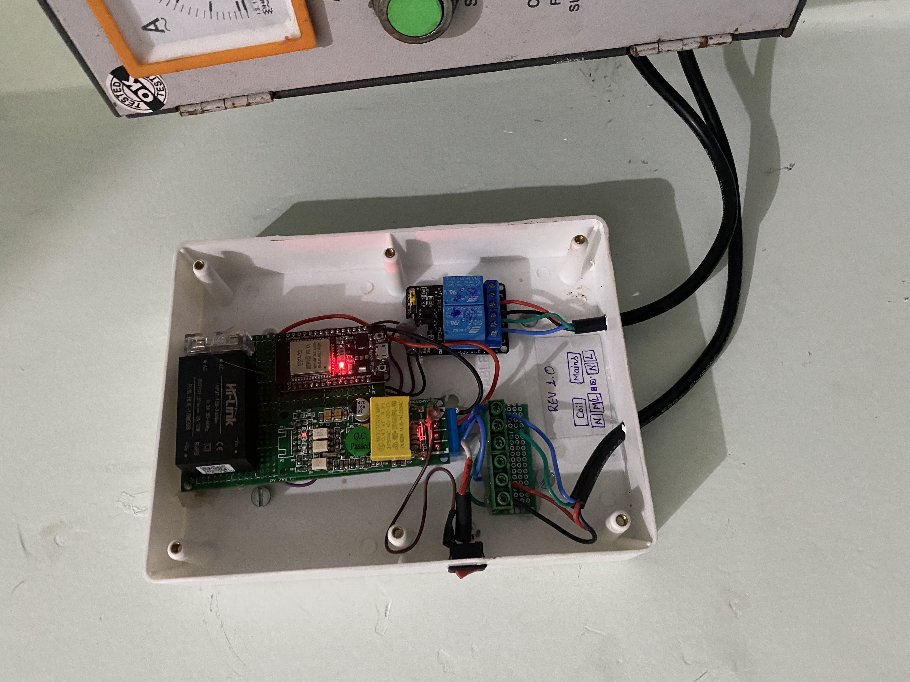
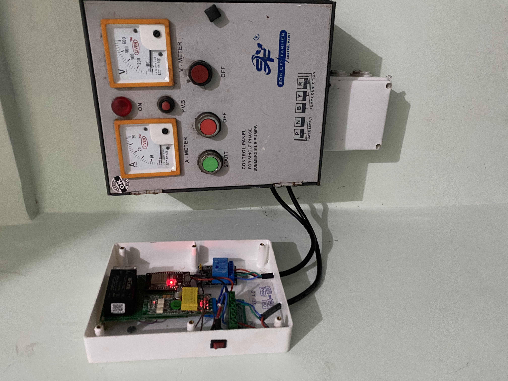

# Momentary Pulse Relay Controller

An open-source smart pump controller built with **ESP32, ESPHome, and Home Assistant**.

The project brings remote pump control, electrical monitoring, configurable automatic shutoff, and scheduled operation into a single smart-home system. It is designed to work alongside an existing pump control panel by using momentary relay pulses to emulate its physical Start and Stop push buttons.

> **Project status: Deployed and under field testing.** The controller has been installed on the actual borewell system and has been operating successfully during its first two days of real-world testing. Extended testing will continue for the next one to two months before the hardware design is finalized.

> **Development note:** This is the initial hardware version, assembled using off-the-shelf modules. A custom PCB and Version 2 (V2) are planned after successful completion of the field-testing period.

## Features

- **Momentary Start/Stop control:** Uses separate relays to emulate the existing panel's physical push buttons.
- **Electrical monitoring:** Reads voltage, current, power, energy consumption, frequency, and power factor through a PZEM-004T energy meter.
- **Current-based running status:** Uses current thresholds to determine whether the pump is running, including changes made through the physical control panel.
- **Configurable auto-off timer:** Set the operating duration from Home Assistant.
- **Daily schedule:** Configure scheduled start and stop times.
- **Independent controls:** Enable or disable the timer, schedule, and bypass mode separately.
- **Home Assistant integration:** Exposes controls and measurements through ESPHome.
- **Over-the-air updates:** Supports firmware updates through ESPHome once the device is configured for OTA operation.
- **ESP32-based design:** Uses readily available hardware and configurable YAML firmware.
- **Existing protection retained:** Designed to operate alongside the original pump control panel rather than replace its motor protection circuitry.

## Project Status and Development Plan

The project has progressed from bench testing to deployment on an actual borewell installation.

### Current stage: V1 field testing

The assembled controller has been operating on the actual borewell for two days, with initial operation reported as successful. The next step is to evaluate its reliability over a longer period under normal operating conditions.

The planned testing period is **one to two months**, covering:

- Reliability of remote Start and Stop commands.
- Correct operation of momentary relay pulses.
- Current-based pump status detection.
- Automatic shutoff and timer lockout behavior.
- Daily scheduling and interactions between manual and scheduled control.
- Operation alongside the original physical control panel.
- Stability of electrical measurements and Home Assistant communication.

### Planned V2: Custom PCB

After the field-testing period, if the system performs reliably, the next development stage will be to design a custom printed circuit board (PCB).

The goal is to move away from the current assembly of separate development boards and modules toward a more integrated, maintainable hardware design.

The V2 design may incorporate lessons learned during field testing, including wiring improvements, component placement, power distribution, and electrical isolation.

**V2 is planned, not yet released.** The existing modular hardware remains the current implementation.

## Connection Diagram

The following diagram shows the wiring architecture of the Momentary Pulse Relay Controller, including the ESP32, PZEM-004T energy meter, power supply, relay module, and existing pump control panel.

 

The relay contacts are intended to operate in parallel with the corresponding physical Start and Stop push buttons, subject to compatibility with the existing control circuit.

Verify the actual terminal markings on each component before wiring. Wire colors in the diagram are illustrative and should not replace proper terminal identification or electrical testing.

## Field Installation

The controller has been installed alongside the existing borewell control panel. The photographs below show the deployed hardware assembly.

  
  

The current version uses separate off-the-shelf modules mounted inside an enclosure. The installation is undergoing an extended field-testing period before the planned custom PCB redesign for V2.

## Hardware

The current implementation uses off-the-shelf modules assembled inside an enclosure. Product links below are placeholders and will be replaced with verified purchase links.

| Component                   | Specification / identification                                                   | Purpose                                  | Product link                            |
| --------------------------- | -------------------------------------------------------------------------------- | ---------------------------------------- | --------------------------------------- |
| ESP32 development board     | ESP32 DevKit-style board with ESP-WROOM-32 module                                | Main controller and Wi-Fi communication  | [Product link](https://xxxxxxxx.com)    |
| Two-channel relay module    | 5 V relay module with two independent relay channels                             | Emulates the Start and Stop push buttons | [Product link](https://xxxxxxxx.com)    |
| PZEM-004T energy meter      | PZEM-004T, 100 A current-transformer variant                                     | AC electrical measurements               | [Product link](https://xxxxxxxx.com)    |
| Current transformer (CT)    | Compatible 100 A CT for the selected PZEM meter                                  | Measures pump current                    | [Product link](https://xxxxxxxx.com)    |
| AC-DC power supply          | Hi-Link HLK-5M05, 5 V / 5 W                                                      | Supplies low-voltage DC power            | [Product link](https://xxxxxxxx.com)    |
| Existing pump control panel | Single-phase submersible pump controller with contactor and protection circuitry | Primary motor switching and protection   | Existing installation                   |
| Home Assistant server       | Home Assistant with ESPHome integration                                          | Dashboard, configuration, and automation | [Project website](https://xxxxxxxx.com) |

### ESP32 board identification

The controller uses an ESP32 development board fitted with an **ESP-WROOM-32 module**. It communicates with Home Assistant over Wi-Fi and runs ESPHome firmware using the ESP-IDF framework.

The exact development-board manufacturer and revision have not yet been verified. Builders should check the module marking and board pinout before purchasing or wiring a replacement.

### ESP32 pin configuration

| GPIO   | Function              |
| ------ | --------------------- |
| GPIO25 | Start relay           |
| GPIO26 | Stop relay            |
| GPIO16 | UART RX for PZEM-004T |
| GPIO17 | UART TX for PZEM-004T |

The relay outputs use inverted logic in the current firmware configuration. Confirm the actual inactive state and contact behavior of the relay module before connecting it to the pump control panel.

The PZEM UART wiring must follow the ESPHome configuration and the pin labels of the specific meter and ESP32 board being used.

## How It Works

### 1. Pump control

Home Assistant sends a Start or Stop command to the ESP32. The controller energizes the corresponding relay for approximately one second and then releases it.

The relay's normally open dry contacts are intended to be connected in parallel with the corresponding physical push button, provided the existing panel's control circuit is compatible.

This arrangement allows the original physical controls to remain available while adding remote operation.

### 2. Electrical monitoring

The PZEM-004T communicates with the ESP32 over UART through the ESPHome `pzemac` and Modbus components.

The meter provides electrical measurements used for monitoring the pump and displaying its operating conditions in Home Assistant.

### 3. Current-based running status

The current-based running indicator uses hysteresis to avoid repeatedly switching between ON and OFF near a threshold.

The current firmware uses the following thresholds:

- **Below 1 A:** Pump considered OFF.
- **Above 6 A:** Pump considered ON.
- **Between 1 A and 6 A:** Retain the previous state.

These thresholds should be adjusted for the actual motor, starting behavior, and operating conditions. Current-based detection is a software indicator and is not a substitute for electrical protection.

### 4. Automatic shutoff

When enabled, the timer stops the pump after the configured operating duration.

A timer-triggered lockout prevents the scheduled start routine from restarting the pump before the lockout is cleared.

Manual Start can clear the lockout and begin a new operating cycle, according to the current firmware logic.

### 5. Daily scheduling

The schedule function allows the user to configure scheduled start and stop times through Home Assistant.

Scheduling behavior and its interaction with the timer, lockout, manual commands, and bypass mode remain part of the extended field-testing process.

### 6. Bypass mode

Bypass mode uses the controller's commanded state instead of the current-based running indicator.

Because it ignores measured current, it cannot reliably reflect pump operations initiated directly at the physical panel while bypass mode is enabled.

Use bypass mode with an understanding of this limitation.

## Software

The project uses the following software components:

- **ESPHome:** Firmware configuration, device management, and OTA updates.
- **Home Assistant:** Remote controls, monitoring, dashboards, and automation.
- **ESP-IDF framework:** ESP32 firmware framework used by the current configuration.
- **PZEM-004T communication:** ESPHome `pzemac` and Modbus components.

The ESPHome YAML configuration is located in the [`esphome/`](esphome/) directory.

## Installation and Configuration

The following steps describe the general setup process for builders adapting this project to their own hardware.

1. Install Home Assistant and the ESPHome integration.
2. Add an ESP32 device in ESPHome.
3. Copy the project configuration from the [`esphome/`](esphome/) directory into the device YAML configuration.
4. Configure Wi-Fi credentials, API encryption keys, and other private settings using ESPHome secrets.
5. Verify the GPIO assignments, relay logic, power supply, PZEM wiring, and UART configuration.
6. Compile and flash the firmware.
7. Add the ESPHome device to Home Assistant.
8. Test sensor readings, relay behavior, and control logic in a safe, isolated test setup.
9. Have a qualified person verify the compatibility of the relay contacts with the existing pump control circuit before installation.
10. Test the complete system under controlled conditions before relying on automated operation.

Keep Wi-Fi credentials and API encryption keys out of public commits. Use `secrets.yaml` for private configuration values.

**Important:** The current installation is a working prototype undergoing extended field testing. The configuration may need adjustment for different ESP32 boards, relay modules, energy meters, or pump control panels.

## Safety

**This project is experimental and is not a certified motor controller or safety system.**

- Mains voltage can cause fatal electric shock. Installation and modifications to mains wiring must be performed by a qualified person.
- Preserve the pump panel's original overload, dry-run, and other protective devices.
- Retain an independent physical Stop control.
- Verify relay isolation, contact ratings, and inactive behavior before connecting to the control panel.
- Confirm that the relay contacts are compatible with the existing control circuit. Do not assume that every pump panel uses the same push-button voltage or wiring.
- The software timer cannot guarantee shutoff if the ESP32 loses power, becomes unresponsive, or loses control of the relay.
- Loss of Wi-Fi or Home Assistant connectivity must not be assumed to stop the pump.
- The current-based running indicator is intended for monitoring, not as a substitute for motor protection.
- Do not use this project as the sole means of preventing flooding, dry running, or other hazardous conditions.

## Roadmap

### V1: Current hardware and field validation

- [x] Bench-test the controller with a sample load.
- [x] Deploy the controller on the actual borewell installation.
- [x] Complete the initial two days of successful operation.
- [ ] Continue field testing for one to two months.
- [ ] Validate automatic shutoff and restart behavior over an extended period.
- [ ] Validate daily scheduling, timer priority, and lockout behavior.
- [ ] Document field-test results and any required firmware changes.
- [ ] Verify the final component list and product links.
- [ ] Add Home Assistant dashboard screenshots and further installation documentation.

### V2: Custom PCB

- [ ] Finalize the V1 design after field testing.
- [ ] Design a custom PCB based on the validated hardware architecture.
- [ ] Review power distribution, electrical isolation, connector selection, and enclosure integration.
- [ ] Prototype and test the custom PCB.
- [ ] Validate V2 hardware and firmware before release.
- [ ] Publish the V2 design files and updated documentation.

The V2 release is conditional on the results of field testing and subsequent hardware validation.

## Contributing

Suggestions, bug reports, and improvements are welcome.

When reporting an issue, please include:

- ESPHome and Home Assistant versions.
- ESP32 development-board and relay-module details.
- PZEM-004T variant and wiring configuration.
- Relevant YAML configuration with all secrets removed.
- Logs, observed behavior, and steps to reproduce the issue.

Contributions that improve reliability, documentation, hardware compatibility, and safety are especially welcome.

## License

Released under the MIT License. See [LICENSE](LICENSE).
